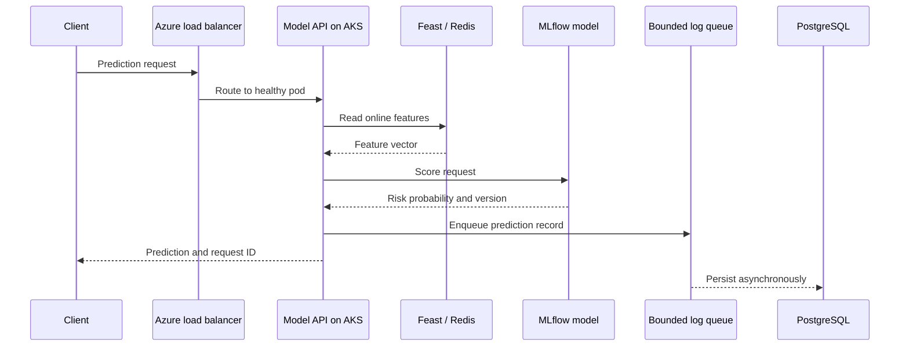

# MLPlatform

MLPlatform is a cloud hosted credit risk MLOps demonstration. Azure Kubernetes Service (AKS) runs the API, dashboard, data services, model jobs and monitoring stack. Terraform defines both Azure infrastructure and Kubernetes workloads. GitHub Actions builds the images, validates changes and runs confirmed cloud operations with Azure OIDC.

The repository does not provide a local application deployment. To start the cloud app, dispatch the Azure workflow from GitHub or with the GitHub CLI.

## Start the cloud app

From a clone with GitHub CLI authenticated to this repository:

```bash
gh workflow run cd.yml --ref main \
  -f action=deploy \
  -f confirmation=DEPLOY
gh run watch --exit-status
```

This sends a deployment request to GitHub. The app runs on AKS; the command does not run the app on your computer. When the workflow finishes, its run summary shows the model API and dashboard addresses.

Open the **dashboard URL** from that summary and sign in as `admin` with the dashboard password. The **Monitoring** tab is the single place to view AKS, model API, Prometheus, MLflow, and MinIO health, active Prometheus alerts, the latest retraining result, and embedded Grafana dashboards. Grafana opens under the same dashboard address at `/grafana/`; its data sources include Prometheus, Alertmanager, and Loki. The prediction API remains a separate endpoint for client applications.

The repository’s `azure` GitHub Environment must already have its Azure variables and OIDC identity configured. For a new Azure subscription, an administrator can run `make azure-connect` while signed in with Azure CLI and GitHub CLI. That one-time setup creates the GitHub deployment identity and repository variables; it does not create the application cluster. Azure deployments require the `DEPLOY` confirmation and a successful CI run for the exact commit.

The model API requires a bearer token for prediction and model information routes. After connecting `kubectl` to the AKS cluster, retrieve it without printing it in the terminal and call the API:

```bash
export MODEL_API_TOKEN="$(kubectl -n serving get secret model-api-token -o jsonpath='{.data.token}' | base64 -d)"
curl -H "Authorization: Bearer ${MODEL_API_TOKEN}" http://<model-api-address>:8080/model-info
unset MODEL_API_TOKEN
```

To stop and delete the project’s Azure app, AKS cluster and Terraform state, run:

```bash
gh workflow run cd.yml --ref main \
  -f action=kill \
  -f confirmation=KILL
gh run watch --exit-status
```

Deletion removes the project’s model and data history too. The GitHub OIDC identity is separate from the application resource groups and remains available for a future deployment.

## From source code to a working app

The following is the actual deployment path. **Pushing code runs CI; it does not deploy Azure resources.** Deployment is a separate, confirmed GitHub Actions run. Your computer only needs GitHub CLI to dispatch it and a browser to use the result.

```mermaid
flowchart LR
    A[Push main] --> B[CI: tests, scans, image smoke]
    B --> C[Confirmed Azure workflow]
    C --> D[Terraform: Azure network, ACR, AKS, IP]
    D --> E[Build and push seven images]
    E --> F[Terraform: namespaces, CRDs, services]
    F --> G[Feast data and initial MLflow champion]
    G --> H[Terraform: API, dashboard, monitors]
    H --> I[Readiness, prediction, metrics, dashboard checks]
    I --> J[Dashboard URL in run summary]
```



### 1. Prepare the repository and Azure identity

The deploy workflow reads [`main`](https://github.com/JaiiMukundh/mlplatform/tree/main). For a new subscription, sign in with Azure CLI and GitHub CLI, then run `make azure-connect` once. [`scripts/azure.sh`](scripts/azure.sh) configures a GitHub OIDC identity and the `azure` GitHub Environment variables, including the permitted operator network. GitHub receives a short-lived Azure token during each run; there is no Azure client secret in this repository. The subscription needs capacity for the AKS node SKUs in [`infra/modules/cluster_aks/main.tf`](infra/modules/cluster_aks/main.tf).

The one-time connection does **not** start the app. It does create an Azure identity, so review the Azure subscription and GitHub Environment before using it.

### 2. Push a change and pass CI

Push the reviewed change to `main`. [`.github/workflows/ci.yml`](.github/workflows/ci.yml) runs `quality` and `security`. It installs the frozen [`uv.lock`](uv.lock) dependency graph, runs Python tests and lint, validates Terraform, GitHub Actions and Kubernetes manifests, checks for secrets and vulnerabilities, then builds and import-smokes all seven targets in [`infra/Dockerfile`](infra/Dockerfile). Those Docker builds are CI checks; they do not start a local app.

The Azure workflow checks that **both CI jobs succeeded for its exact commit SHA**. If either fails, inspect that CI run first; the Azure job will not continue to provisioning.

### 3. Dispatch deployment

From the repository checkout, run:

```bash
gh workflow run cd.yml --ref main -f action=deploy -f confirmation=DEPLOY
gh run list --workflow cd.yml --limit 3
gh run watch --exit-status
```

Alternatively, choose **Actions → azure → Run workflow** on GitHub, select `deploy`, and enter `DEPLOY`. The command dispatches [`.github/workflows/cd.yml`](.github/workflows/cd.yml) on a GitHub-hosted runner. Do not dispatch another deploy while one is running.

### 4. Provision Azure, then Kubernetes

[`infra/envs/azure/`](infra/envs/azure/) uses Terraform to create the project resource group, network, Azure Container Registry (ACR), AKS, budget alert, and public IP. The GitHub runner builds and pushes the seven tagged images to ACR. [`infra/envs/aks/`](infra/envs/aks/) then applies Kubernetes resources in dependency order:

| Stage | What becomes available | Source |
|---|---|---|
| Bootstrap | Namespaces, service accounts and required custom resource definitions | [`infra/envs/aks/`](infra/envs/aks/) |
| Platform | PostgreSQL, Redis, MinIO, MLflow, Prometheus, Alertmanager, Grafana, Loki and Alloy | [`infra/manifests/`](infra/manifests/) |
| Application | Model API, dashboard, drift monitor, remediator, services and release Job templates | [`infra/manifests/`](infra/manifests/) |

Terraform manages the cluster resources directly. There is no Helm deployment. Kubernetes schedules the containers and Jobs; Azure load balancing exposes the dashboard and API.

### 5. Seed features and create the first model

On the **first** deployment, [`scripts/azure.sh`](scripts/azure.sh) publishes the credit data to MinIO, runs the Feast apply/materialize/verify Jobs, trains the baseline model through [`scripts/train_mlflow.sh`](scripts/train_mlflow.sh), and registers it in MLflow with a `champion` alias. Only then does the app stage start the API with that version. On later deploys, the script checks the existing alias and keeps the model and data history instead of training a fresh version each time.

The API reads online features from Feast/Redis, loads the registered model, and writes prediction records to PostgreSQL. The dashboard starts after its data and model dependencies are available.

### 6. Prove the deployment is working

The deployment run waits for the API and dashboard rollouts. Its verification checks API `/readyz`, authenticated `/model-info` and `/predict`, API `/metrics`, dashboard `/healthz`, and dashboard status showing ready nodes, a serving model, Prometheus, MLflow and MinIO. **A successful CI run alone is not proof that the app is deployed.** The Azure run must finish successfully and show the dashboard URL in its summary.

Afterward, open the dashboard URL, sign in as `admin`, and use **Monitoring** for service health, active alerts and Grafana. The dashboard password is stored in the `observability/grafana-admin` Kubernetes Secret. If you have authorized `kubectl` access, retrieve it without echoing it:

```bash
DASHBOARD_PASSWORD="$(kubectl -n observability get secret grafana-admin -o jsonpath='{.data.admin-password}' | base64 -d)"
curl -k -u "admin:${DASHBOARD_PASSWORD}" "https://<dashboard-ip>/api/status"
unset DASHBOARD_PASSWORD
```

The test dashboard uses a self-signed HTTPS certificate, so a browser may show a certificate warning. Use the **current run summary** for its IP; an IP from a previous deployment may no longer belong to this app. The authenticated dashboard and `/grafana/` share one URL. The model API is a separate endpoint because client applications use its bearer token.

### 7. Exercise drift and model release

In the dashboard, run **Simulate drift**. [`scripts/simulate_drift.py`](scripts/simulate_drift.py) publishes shifted features, a Feast Job materializes them in Redis, and [`scripts/traffic.py`](scripts/traffic.py) sends prediction traffic. [`core/drift_monitor/main.py`](core/drift_monitor/main.py) compares recent predictions with the champion reference and, after two consecutive breaches, creates a retraining Job. [`core/retrain/main.py`](core/retrain/main.py) registers a candidate in MLflow. [`scripts/model_release.sh`](scripts/model_release.sh) runs the evaluation gate, deploys and load-checks staging, changes the MLflow `champion` alias, rolls production one pod at a time, and verifies production predictions. The dashboard's status shows the serving version; the Kubernetes Job status and logs show whether retraining and release actually completed.

### 8. Stop the test session

The deploy run tags the app and Terraform state groups with an expiry **two hours after deployment finishes**. [`.github/workflows/expiry.yml`](.github/workflows/expiry.yml) checks every 15 minutes and deletes expired test resources; scheduling can be delayed. Use the `kill` command above to end the session sooner. Both expiry and `kill` remove the test data, model history, AKS resources and Terraform state. Check the current run summary for the actual expiry time rather than assuming an old session is still running.

## What the platform does

1. Prepares historical credit card data and trains a model.
2. Registers model artifacts and versions in MLflow, with artifacts stored in MinIO.
3. Serves predictions from FastAPI using online features from Feast and Redis.
4. Writes prediction records to PostgreSQL asynchronously so database work does not block the response.
5. Monitors feature drift and can schedule retraining jobs. A candidate model passes an evaluation gate before release.
6. Shows system health and model operations in an authenticated dashboard.
7. Collects metrics, alerts and logs with Prometheus, Alertmanager, Grafana, Loki and Alloy; a bounded remediator can handle selected conditions.

This is an engineering demonstration, not a validated lending product. It uses the UCI Taiwan Credit Card Default dataset. Snapshot timelines and injected drift are simulated. The project does not claim production credit performance, fairness, latency or availability results.

## Architecture

```mermaid
flowchart TB
    subgraph Delivery[Source and cloud delivery]
        Code[Reviewed change] --> CI[GitHub CI<br/>quality and security]
        CI --> Images[Build and scan seven image targets]
        OIDC[GitHub OIDC identity] --> Dispatch[Confirmed Azure workflow]
        Dispatch --> TFCloud[Azure Terraform root]
        Images --> ACR[Azure Container Registry]
        TFCloud --> AKS[Azure Kubernetes Service]
        TFWorkloads[AKS Terraform root<br/>bootstrap, platform, app] --> AKS
        ACR --> AKS
    end

    subgraph Runtime[Azure cloud runtime]
        LB[Azure load balancer] --> API[FastAPI model API]
        LB --> UI[Operations dashboard]
        API --> Feast[Feast and Redis]
        API --> MLflow[MLflow registry]
        API -. queued prediction logs .-> PG[PostgreSQL]
        MinIO[MinIO artifact and offline store] --> MLflow
        MinIO --> Train[Training and retraining Jobs]
        Feast --> Train
        Train --> MLflow
        PG --> Drift[Drift monitor]
        MLflow --> Gate[Candidate evaluation gate]
        Drift --> Train
        Gate --> API
        Metrics[Prometheus and Alertmanager] --> Remediator[Remediator]
        Remediator --> API
        Logs[Loki and Alloy] --> UI
        Metrics --> UI
    end
```



### Prediction request



An accepted prediction can return before its database record is written. The queue has a fixed capacity; a full queue or final flush failure can drop records and is surfaced through logs and metrics.

### Deployment order

```mermaid
flowchart LR
    A[GitHub-hosted runner] --> B[Azure Terraform]
    B --> C[Network, AKS, ACR, public IP]
    C --> D[AKS bootstrap: namespaces and CRDs]
    D --> E[Platform: data and observability]
    E --> F[Initial data and model]
    F --> G[App: API, dashboard, jobs]
    G --> H[Smoke and health checks]
    H --> I[Timed cleanup or confirmed teardown]
```



`infra/envs/azure` manages Azure resources. `infra/envs/aks` manages Kubernetes resources through Terraform’s Kubernetes provider. Staged applies allow the cluster, namespaces, CRDs, data services and application to become available in dependency order. The cloud workflow runs on a GitHub-hosted runner, uses OIDC for Azure access and checks successful CI for the exact commit before deployment.

## CI/CD workflows

The workflow definitions are in [`.github/workflows/`](.github/workflows/):

| Workflow | File | When it runs | What it does |
|---|---|---|---|
| `ci` | [`ci.yml`](.github/workflows/ci.yml) | Pull requests and pushes to `main` | Lint and test Python; validate Terraform, actions and Kubernetes manifests; scan secrets and dependencies; build and smoke test all seven Docker targets. |
| `azure` | [`cd.yml`](.github/workflows/cd.yml) | Manual dispatch from `main`; model release dispatch | Plan, deploy, verify, update dashboard access, release a candidate, sleep, wake, destroy or fully delete the Azure environment. Billable/destructive operations require an explicit confirmation. |
| `azure-expiry` | [`expiry.yml`](.github/workflows/expiry.yml) | Scheduled check every 15 minutes | Deletes an expired test deployment and verifies the application and Terraform-state groups are gone. |

## Alert quick checks

These are first checks for the alerts configured in Prometheus. Inspect the AKS workload and logs through the authenticated dashboard or the Azure workflow runner.

### Model API down

Check the `serving` deployment and pod logs, then verify Redis, MLflow and PostgreSQL in `data`. If the outage followed a release, use the rollback procedure in `scripts/model_release.sh`.

### Pod crash looping

Inspect the container’s termination reason, readiness failures and memory limits. Confirm the selected model exists in MLflow and the Feast online store responds.

### High error rate

Check prediction response codes and model API logs. Confirm feature hydration in Redis and the champion alias in MLflow before rolling back a recent release.

### High p95 latency

Inspect API pod resources, HPA status, Prometheus request latency and dependency latency. The remediator can raise the HPA minimum replica count.

### Model drift detected

Check the drift window size, consecutive breaches, cooldown, MLflow reference artifact and retraining Job. Demo drift injection is simulated.

### Retrain failed

Inspect the retraining Job and its Feast and MLflow dependencies. A candidate must pass the release gate before promotion; the current champion should remain serving while the failure is resolved.

## Run checks

These commands check source and infrastructure definitions. They do not deploy or start the application:

```bash
uv sync --frozen --all-groups
make lint test
make check-infra check-actions check-manifests
make secret-scan security
```

`make check-images` builds and smoke tests the Docker image targets and uses local Docker as a build tool. It does not launch the MLPlatform application. No local app server or local cluster is part of the deployment path.

## Why `uv.lock` is here

[`uv.lock`](uv.lock) records exact versions and hashes for the Python dependency graph, including indirect dependencies. CI and the Azure workflow use `uv sync --frozen`, so the same reviewed dependency set is installed each time. The file is about 236 KB in the current checkout; removing it would make builds less reproducible, so it is intentionally checked in.

## Technology at a glance

| Capability | Included |
|---|---|
| Kubernetes | Yes — AKS runs and orchestrates the application workloads. |
| Load balancing | Yes — Kubernetes `LoadBalancer` services use Azure load balancing and a Terraform-managed public IP. |
| Orchestration | Yes — Kubernetes schedules containers, health checks, rollouts and Jobs; Terraform provisions infrastructure in stages. |
| Dockerfiles | Yes — one multi-stage [`infra/Dockerfile`](infra/Dockerfile) defines seven image targets. |
| Helm | No — Azure and Kubernetes deployment definitions are Terraform. |

## Repository map

| Path | Purpose |
|---|---|
| `core/model_api/` | FastAPI prediction service and request logging |
| `core/ml/`, `core/feature_repo/` | Feature preparation, training, evaluation and Feast definitions |
| `core/drift_monitor/`, `core/retrain/`, `core/remediator/` | Drift detection, retraining and bounded remediation |
| `ui/` | Operations dashboard served from AKS |
| `infra/envs/azure/` | Azure infrastructure Terraform root |
| `infra/envs/aks/` | Kubernetes workload Terraform root |
| `infra/manifests/`, `infra/jobs/` | Terraform inputs and Kubernetes Job definitions |
| `infra/Dockerfile` | Multi-stage image definitions |
| `scripts/` | Cloud workflow, validation, release and smoke-check helpers |
| `.github/workflows/` | CI, Azure operations and expiry cleanup |
| `tests/` | Unit tests and cloud configuration checks |
