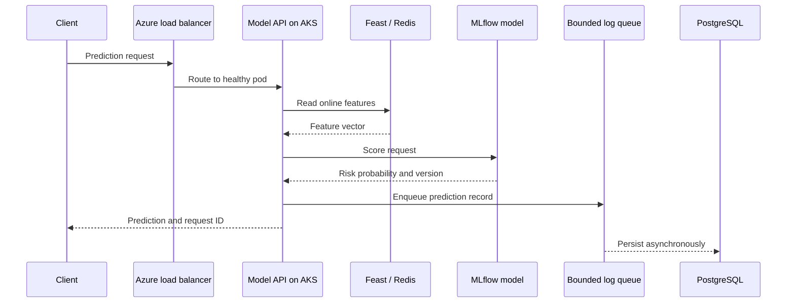

# MLPlatform

MLPlatform is a cloud hosted credit risk MLOps demonstration. Azure Kubernetes Service (AKS) runs the API, dashboard, data services, model jobs and monitoring stack. Terraform defines both Azure infrastructure and Kubernetes workloads. GitHub Actions builds the images, validates changes and runs confirmed cloud operations with Azure OIDC.

The repository does not provide a local application deployment. The deployed application runs on Azure AKS. Your computer can dispatch the Azure workflow with GitHub CLI and open the dashboard in a browser, but it does not host the application.

## Open the currently deployed app

The last verified public dashboard address is [https://mlp-test-b3e0c60e.indiasouthcentral.cloudapp.azure.com](https://mlp-test-b3e0c60e.indiasouthcentral.cloudapp.azure.com). Its `/healthz` endpoint returned HTTP 200 on **23 October 2026**. This address belongs to a temporary Azure test deployment and can stop working when the deployment expires; use the latest successful `azure` workflow summary as the source of truth. The browser may show a certificate warning because Terraform creates a self-signed certificate for the demo dashboard. The model API's unauthenticated readiness probe is [http://172.198.72.55:8080/readyz](http://172.198.72.55:8080/readyz); model information and predictions at that host require the bearer token.

Sign in to the dashboard with username `admin`. The password is not published in this README or Git; retrieve it from the `grafana-admin` Kubernetes Secret using the command in [Prove the deployment is working](#6-prove-the-deployment-is-working). The dashboard's **Monitoring** tab is the shared view for service health, alerts, retraining state, and embedded Grafana. The separate model API is intended for authenticated application clients.

## Start the cloud app

From a clone with GitHub CLI authenticated to this repository:

```bash
gh workflow run cd.yml --ref main \
  -f action=deploy \
  -f confirmation=DEPLOY
gh run list --workflow cd.yml --limit 3
# Copy the new run ID from the list, then follow that exact run:
gh run watch <RUN_ID> --exit-status
```

This sends a deployment request to GitHub. The app runs on AKS; the command does not run the app on your computer. When the workflow finishes, its run summary shows the model API and dashboard addresses. This is the cloud startup command; there is no local app server command.

Open the **dashboard URL** from that summary and sign in as `admin` with the dashboard password. The **Monitoring** tab is the single place to view AKS, model API, Prometheus, MLflow, and MinIO health, active Prometheus alerts, the latest retraining result, and embedded Grafana dashboards. Grafana opens under the same dashboard address at `/grafana/`; its data sources include Prometheus, Alertmanager, and Loki. The prediction API remains a separate endpoint for client applications.

The repository’s `azure` GitHub Environment must already have its Azure variables and OIDC identity configured. For a new Azure subscription, an administrator can run `make azure-connect` while signed in with Azure CLI and GitHub CLI. That one-time setup creates the GitHub deployment identity and repository variables; it does not create the application cluster. Azure deployments require the `DEPLOY` confirmation and a successful CI run for the exact commit.

The model API requires a bearer token for prediction and model information routes. After connecting `kubectl` to the AKS cluster, retrieve it without printing it in the terminal and call the API:

```bash
export MODEL_API_TOKEN="$(kubectl -n serving get secret model-api-token -o jsonpath='{.data.token}' | base64 -d)"
curl -H "Authorization: Bearer ${MODEL_API_TOKEN}" http://<model-api-address>:8080/model-info
unset MODEL_API_TOKEN
```

To stop and delete the project’s Azure app, AKS cluster and Terraform state, run:

```bash
gh workflow run cd.yml --ref main \
  -f action=kill \
  -f confirmation=KILL
gh run watch --exit-status
```

Deletion removes the project’s model and data history too. The GitHub OIDC identity is separate from the application resource groups and remains available for a future deployment.

## From source code to a working app

The following is the actual deployment path. **Pushing code runs CI; it does not deploy Azure resources.** Deployment is a separate, confirmed GitHub Actions run. Your computer only needs GitHub CLI to dispatch it and a browser to use the result.

```mermaid
flowchart LR
    A[Push main] --> B[CI: tests, scans, image smoke]
    B --> C[Confirmed Azure workflow]
    C --> D[Terraform: Azure network, ACR, AKS, IP]
    D --> E[Build and push seven images]
    E --> F[Terraform: namespaces, CRDs, services]
    F --> G[Feast data and initial MLflow champion]
    G --> H[Terraform: API, dashboard, monitors]
    H --> I[Readiness, prediction, metrics, dashboard checks]
    I --> J[Dashboard URL in run summary]
```



### 1. Prepare the repository and Azure identity

The deploy workflow reads [`main`](https://github.com/JaiiMukundh/mlplatform/tree/main). For a new subscription, sign in with Azure CLI and GitHub CLI, then run `make azure-connect` once. [`scripts/azure.sh`](scripts/azure.sh) configures a GitHub OIDC identity and the `azure` GitHub Environment variables, including the permitted operator network. GitHub receives a short-lived Azure token during each run; there is no Azure client secret in this repository. The subscription needs capacity for the AKS node SKUs in [`infra/modules/cluster_aks/main.tf`](infra/modules/cluster_aks/main.tf).

The one-time connection does **not** start the app. It does create an Azure identity, so review the Azure subscription and GitHub Environment before using it.

### 2. Push a change and pass CI

Push the reviewed change to `main`. [`.github/workflows/ci.yml`](.github/workflows/ci.yml) runs `quality` and `security`. It installs the frozen [`uv.lock`](uv.lock) dependency graph, runs Python tests and lint, validates Terraform, GitHub Actions and Kubernetes manifests, checks for secrets and vulnerabilities, then builds and import-smokes all seven targets in [`infra/Dockerfile`](infra/Dockerfile). Those Docker builds are CI checks; they do not start a local app.

The Azure workflow checks that **both CI jobs succeeded for its exact commit SHA**. If either fails, inspect that CI run first; the Azure job will not continue to provisioning.

### 3. Dispatch deployment

From the repository checkout, run:

```bash
gh workflow run cd.yml --ref main -f action=deploy -f confirmation=DEPLOY
gh run list --workflow cd.yml --limit 3
gh run watch --exit-status
```

Alternatively, choose **Actions → azure → Run workflow** on GitHub, select `deploy`, and enter `DEPLOY`. The command dispatches [`.github/workflows/cd.yml`](.github/workflows/cd.yml) on a GitHub-hosted runner. Do not dispatch another deploy while one is running.

### 4. Provision Azure, then Kubernetes

[`infra/envs/azure/`](infra/envs/azure/) uses Terraform to create the project resource group, network, Azure Container Registry (ACR), AKS, budget alert, and public IP. The GitHub runner builds and pushes the seven tagged images to ACR. [`infra/envs/aks/`](infra/envs/aks/) then applies Kubernetes resources in dependency order:

| Stage | What becomes available | Source |
|---|---|---|
| Bootstrap | Namespaces, service accounts and required custom resource definitions | [`infra/envs/aks/`](infra/envs/aks/) |
| Platform | PostgreSQL, Redis, MinIO, MLflow, Prometheus, Alertmanager, Grafana, Loki and Alloy | [`infra/manifests/`](infra/manifests/) |
| Application | Model API, dashboard, drift monitor, remediator, services and release Job templates | [`infra/manifests/`](infra/manifests/) |

Terraform manages the cluster resources directly. There is no Helm deployment. Kubernetes schedules the containers and Jobs; Azure load balancing exposes the dashboard and API.

### 5. Seed features and create the first model

On the **first** deployment, [`scripts/azure.sh`](scripts/azure.sh) publishes the credit data to MinIO, runs the Feast apply/materialize/verify Jobs, trains the baseline model through [`scripts/train_mlflow.sh`](scripts/train_mlflow.sh), and registers it in MLflow with a `champion` alias. Only then does the app stage start the API with that version. On later deploys, the script checks the existing alias and keeps the model and data history instead of training a fresh version each time.

The API reads online features from Feast/Redis, loads the registered model, and writes prediction records to PostgreSQL. The dashboard starts after its data and model dependencies are available.

### 6. Prove the deployment is working

The deployment run waits for the API and dashboard rollouts. Its verification checks API `/readyz`, authenticated `/model-info` and `/predict`, API `/metrics`, dashboard `/healthz`, and dashboard status showing ready nodes, a serving model, Prometheus, MLflow and MinIO. **A successful CI run alone is not proof that the app is deployed.** The Azure run must finish successfully and show the dashboard URL in its summary.

Afterward, open the dashboard URL, sign in as `admin`, and use **Monitoring** for service health, active alerts and Grafana. The dashboard password is stored in the `observability/grafana-admin` Kubernetes Secret. If you have authorized `kubectl` access, retrieve it without echoing it:

```bash
DASHBOARD_PASSWORD="$(kubectl -n observability get secret grafana-admin -o jsonpath='{.data.admin-password}' | base64 -d)"
curl -k -u "admin:${DASHBOARD_PASSWORD}" "https://<dashboard-ip>/api/status"
unset DASHBOARD_PASSWORD
```

The test dashboard uses a self-signed HTTPS certificate, so a browser may show a certificate warning. Use the **current run summary** for its IP; an IP from a previous deployment may no longer belong to this app. The authenticated dashboard and `/grafana/` share one URL. The model API is a separate endpoint because client applications use its bearer token.

### 7. Exercise drift and model release

In the dashboard, run **Simulate drift**. [`scripts/simulate_drift.py`](scripts/simulate_drift.py) publishes shifted features, a Feast Job materializes them in Redis, and [`scripts/traffic.py`](scripts/traffic.py) sends prediction traffic. [`core/drift_monitor/main.py`](core/drift_monitor/main.py) compares recent predictions with the champion reference and, after two consecutive breaches, creates a retraining Job. [`core/retrain/main.py`](core/retrain/main.py) registers a candidate in MLflow. [`scripts/model_release.sh`](scripts/model_release.sh) runs the evaluation gate, deploys and load-checks staging, changes the MLflow `champion` alias, rolls production one pod at a time, and verifies production predictions. The dashboard's status shows the serving version; the Kubernetes Job status and logs show whether retraining and release actually completed.

### 8. Stop the test session

The deploy run tags the app and Terraform state groups with an expiry **two hours after deployment finishes**. [`.github/workflows/expiry.yml`](.github/workflows/expiry.yml) checks every 15 minutes and deletes expired test resources; scheduling can be delayed. Use the `kill` command above to end the session sooner. Both expiry and `kill` remove the test data, model history, AKS resources and Terraform state. Check the current run summary for the actual expiry time rather than assuming an old session is still running.

## What the platform does

1. Prepares historical credit card data and trains a model.
2. Registers model artifacts and versions in MLflow, with artifacts stored in MinIO.
3. Serves predictions from FastAPI using online features from Feast and Redis.
4. Writes prediction records to PostgreSQL asynchronously so database work does not block the response.
5. Monitors feature drift and can schedule retraining jobs. A candidate model passes an evaluation gate before release.
6. Shows system health and model operations in an authenticated dashboard.
7. Collects metrics, alerts and logs with Prometheus, Alertmanager, Grafana, Loki and Alloy; a bounded remediator can handle selected conditions.

This is an engineering demonstration, not a validated lending product. It uses the UCI Taiwan Credit Card Default dataset. Snapshot timelines and injected drift are simulated. The project does not claim production credit performance, fairness, latency or availability results.

## Architecture

```mermaid
flowchart TB
    subgraph Delivery[Source and cloud delivery]
        Code[Reviewed change] --> CI[GitHub CI<br/>quality and security]
        CI --> Images[Build and scan seven image targets]
        OIDC[GitHub OIDC identity] --> Dispatch[Confirmed Azure workflow]
        Dispatch --> TFCloud[Azure Terraform root]
        Images --> ACR[Azure Container Registry]
        TFCloud --> AKS[Azure Kubernetes Service]
        TFWorkloads[AKS Terraform root<br/>bootstrap, platform, app] --> AKS
        ACR --> AKS
    end

    subgraph Runtime[Azure cloud runtime]
        LB[Azure load balancer] --> API[FastAPI model API]
        LB --> UI[Operations dashboard]
        API --> Feast[Feast and Redis]
        API --> MLflow[MLflow registry]
        API -. queued prediction logs .-> PG[PostgreSQL]
        MinIO[MinIO artifact and offline store] --> MLflow
        MinIO --> Train[Training and retraining Jobs]
        Feast --> Train
        Train --> MLflow
        PG --> Drift[Drift monitor]
        MLflow --> Gate[Candidate evaluation gate]
        Drift --> Train
        Gate --> API
        Metrics[Prometheus and Alertmanager] --> Remediator[Remediator]
        Remediator --> API
        Logs[Loki and Alloy] --> UI
        Metrics --> UI
    end
```



### Prediction request



An accepted prediction can return before its database record is written. The queue has a fixed capacity; a full queue or final flush failure can drop records and is surfaced through logs and metrics.

### Deployment order

```mermaid
flowchart LR
    A[GitHub-hosted runner] --> B[Azure Terraform]
    B --> C[Network, AKS, ACR, public IP]
    C --> D[AKS bootstrap: namespaces and CRDs]
    D --> E[Platform: data and observability]
    E --> F[Initial data and model]
    F --> G[App: API, dashboard, jobs]
    G --> H[Smoke and health checks]
    H --> I[Timed cleanup or confirmed teardown]
```



`infra/envs/azure` manages Azure resources. `infra/envs/aks` manages Kubernetes resources through Terraform’s Kubernetes provider. Staged applies allow the cluster, namespaces, CRDs, data services and application to become available in dependency order. The cloud workflow runs on a GitHub-hosted runner, uses OIDC for Azure access and checks successful CI for the exact commit before deployment.

## CI/CD workflows

The workflow definitions are in [`.github/workflows/`](.github/workflows/):

| Workflow | File | When it runs | What it does |
|---|---|---|---|
| `ci` | [`ci.yml`](.github/workflows/ci.yml) | Pull requests and pushes to `main` | Lint and test Python; validate Terraform, actions and Kubernetes manifests; scan secrets and dependencies; build and smoke test all seven Docker targets. |
| `azure` | [`cd.yml`](.github/workflows/cd.yml) | Manual dispatch from `main`; model release dispatch | Plan, deploy, verify, update dashboard access, release a candidate, sleep, wake, destroy or fully delete the Azure environment. Billable/destructive operations require an explicit confirmation. |
| `azure-expiry` | [`expiry.yml`](.github/workflows/expiry.yml) | Scheduled check every 15 minutes | Deletes an expired test deployment and verifies the application and Terraform-state groups are gone. |

## Alert quick checks

These are first checks for the alerts configured in Prometheus. Inspect the AKS workload and logs through the authenticated dashboard or the Azure workflow runner.

### Model API down

Check the `serving` deployment and pod logs, then verify Redis, MLflow and PostgreSQL in `data`. If the outage followed a release, use the rollback procedure in `scripts/model_release.sh`.

### Pod crash looping

Inspect the container’s termination reason, readiness failures and memory limits. Confirm the selected model exists in MLflow and the Feast online store responds.

### High error rate

Check prediction response codes and model API logs. Confirm feature hydration in Redis and the champion alias in MLflow before rolling back a recent release.

### High p95 latency

Inspect API pod resources, HPA status, Prometheus request latency and dependency latency. The remediator can raise the HPA minimum replica count.

### Model drift detected

Check the drift window size, consecutive breaches, cooldown, MLflow reference artifact and retraining Job. Demo drift injection is simulated.

### Retrain failed

Inspect the retraining Job and its Feast and MLflow dependencies. A candidate must pass the release gate before promotion; the current champion should remain serving while the failure is resolved.

## Run checks

These commands check source and infrastructure definitions. They do not deploy or start the application:

```bash
uv sync --frozen --all-groups
make lint test
make check-infra check-actions check-manifests
make secret-scan security
```

`make check-images` builds and smoke tests the Docker image targets and uses local Docker as a build tool. It does not launch the MLPlatform application. No local app server or local cluster is part of the deployment path.

## Why `uv.lock` is here

[`uv.lock`](uv.lock) records exact versions and hashes for the Python dependency graph, including indirect dependencies. CI and the Azure workflow use `uv sync --frozen`, so the same reviewed dependency set is installed each time. The file is about 236 KB in the current checkout; removing it would make builds less reproducible, so it is intentionally checked in.

## Technology at a glance

| Capability | Included |
|---|---|
| Kubernetes | Yes — AKS runs and orchestrates the application workloads. |
| Load balancing | Yes — Kubernetes `LoadBalancer` services use Azure load balancing and a Terraform-managed public IP. |
| Orchestration | Yes — Kubernetes schedules containers, health checks, rollouts and Jobs; Terraform provisions infrastructure in stages. |
| Dockerfiles | Yes — one multi-stage [`infra/Dockerfile`](infra/Dockerfile) defines seven image targets. |
| Helm | No — Azure and Kubernetes deployment definitions are Terraform. |

## Repository map

| Path | Purpose |
|---|---|
| `core/model_api/` | FastAPI prediction service and request logging |
| `core/ml/`, `core/feature_repo/` | Feature preparation, training, evaluation and Feast definitions |
| `core/drift_monitor/`, `core/retrain/`, `core/remediator/` | Drift detection, retraining and bounded remediation |
| `ui/` | Operations dashboard served from AKS |
| `infra/envs/azure/` | Azure infrastructure Terraform root |
| `infra/envs/aks/` | Kubernetes workload Terraform root |
| `infra/manifests/`, `infra/jobs/` | Terraform inputs and Kubernetes Job definitions |
| `infra/Dockerfile` | Multi-stage image definitions |
| `scripts/` | Cloud workflow, validation, release and smoke-check helpers |
| `.github/workflows/` | CI, Azure operations and expiry cleanup |
| `tests/` | Unit tests and cloud configuration checks |

## Detailed code walkthrough

This section follows the runtime through the actual files. It describes the responsibilities and interactions of the main implementation units; it is meant to make code navigation practical. For exact behavior, defaults, and validation rules, the linked source is authoritative.

### 1. Shared contracts and common utilities

| File | What the code does | Why the rest of the app depends on it |
|---|---|---|
| [`core/mlp_common/schemas.py`](core/mlp_common/schemas.py) | Defines the canonical 23-feature order, customer ID/probability constraints, strict request/response models, model metadata and health response. `extra="forbid"` makes an unexpected JSON field an explicit 422 error instead of silently ignoring a typo. | Training, serving, Feast, the dashboard clients and drift calculations must agree on feature names, order and data shape. |
| [`core/ml/data/schemas.py`](core/ml/data/schemas.py) | Names `customer_id`, `event_timestamp` and `default_next_90d`; exposes the same feature list as common schemas; validates exact column order, missing values and binary labels. | Stops malformed Parquet from reaching Feast or training. |
| [`core/mlp_common/config.py`](core/mlp_common/config.py) | Loads environment-backed settings through Pydantic, normalizes log levels and provides defaults for drift interval, minimum sample count, PSI/KS thresholds, feature count, consecutive breaches and cooldown. | Container configuration stays explicit and validated rather than being scattered through startup code. |
| [`core/mlp_common/logging.py`](core/mlp_common/logging.py) | Writes compact JSON to stdout. A `ContextVar` binds a request ID to async work; formatter adds timestamp, severity, service and request ID, plus structured fields and exceptions. | Kubernetes collects stdout; request IDs connect API responses to logs across asynchronous code. |
| [`core/mlp_common/drift.py`](core/mlp_common/drift.py) | Implements PSI using reference quantile bins and a two-sample Kolmogorov–Smirnov statistic. A feature breaches if PSI exceeds its threshold or both KS conditions pass; the population breaches only when enough features do. Empty data and constant-reference cases are handled explicitly. | Shared, deterministic drift math can be unit tested independently of PostgreSQL, Prometheus or Kubernetes. |
| [`core/mlp_common/s3.py`](core/mlp_common/s3.py) | Currently contains no active helper implementation. The application uses Boto3/PyArrow/MLflow clients directly at the call sites that need MinIO. | It is listed so readers do not infer that it hides a runtime storage client today. |

### 2. Prediction API, request by request

The API image starts `uvicorn model_api.main:app` from [`infra/Dockerfile`](infra/Dockerfile). `create_app()` in [`core/model_api/main.py`](core/model_api/main.py) builds the FastAPI app, installs metrics and middleware, then uses FastAPI's lifespan hook to create providers, load model metadata, start the asynchronous prediction logger and shut that logger down gracefully when the pod exits.

| Source | Responsibility and execution details |
|---|---|
| [`core/model_api/main.py`](core/model_api/main.py) | `observe_request` accepts or generates `x-request-id`, checks a bearer token with constant-time comparison, measures duration, emits request metrics and echoes the ID. `/healthz` is liveness; `/readyz` checks that model and feature providers exist and the online store responds; `/metrics` renders the Prometheus registry; `/model-info` reports the immutable loaded version; `/predict` validates a batch, obtains feature rows, rejects unknown IDs, calls `predict_proba`, converts probability to label at 0.5, increments prediction counters and queues one log record per customer. Optional `/debug/*` routes exist only when chaos is explicitly enabled. |
| [`core/model_api/deps.py`](core/model_api/deps.py) | `ModelApiSettings` reads model name/version, source selection, feature service, MLflow/Redis/database URLs and chaos flag. Provider construction supports the configured MLflow model and Feast feature provider. A bounded retry loop waits for dependencies up to 60 seconds, sleeping 2 seconds between failures, then fails startup loudly. |
| [`core/model_api/providers/base.py`](core/model_api/providers/base.py) | Protocols define the small serving contracts: a feature source returns an ID-indexed DataFrame and supports `ping`; a model source exposes version, ordered feature names and probabilities. Tests can inject in-memory implementations without changing HTTP handlers. |
| [`core/model_api/providers/mlflow_model.py`](core/model_api/providers/mlflow_model.py) | Loads `models:/<name>/<version>` from MLflow, discovers feature names from sklearn or MLflow signature, captures registry run/version timestamps, and reorders columns to the model's expected order before scoring. It loads a pinned numeric model version, not a moving alias, so every running pod has a stable version. |
| [`core/model_api/providers/feast_features.py`](core/model_api/providers/feast_features.py) | Reads the Feast Redis online-store representation with Redis pipelining. It builds Feast entity keys, hashes feature-view names into fields, decodes supported tagged values, preserves the canonical 23-column order, and fails on malformed/missing values or an unknown serialization tag. This intentionally avoids importing Feast into the serving dependency set. |
| [`core/model_api/metrics.py`](core/model_api/metrics.py) | Creates an isolated Prometheus registry with HTTP count/latency, prediction count, loaded model identity, feature fetch duration, queue size and database flush-failure collectors. Separate registries prevent test app instances from colliding. |
| [`core/model_api/predlog.py`](core/model_api/predlog.py) | Stores records in a bounded in-memory async queue (10,000 rows). A background task batches up to 200 rows and flushes on a 2-second window. PostgreSQL writes run off the event loop in a transaction; failures are retried with exponential backoff up to 30 seconds. Shutdown drains the queue. Queue-full or final shutdown-write failures are logged and counted; an API response is not delayed for database I/O. |
| [`core/model_api/chaos.py`](core/model_api/chaos.py) | Keeps optional per-process artificial latency and crash helpers. The latency uses non-blocking `asyncio.sleep`; crash exits the selected pod so Kubernetes can demonstrate recovery. Chaos endpoints are not a normal production feature and are disabled by default. |
| [`core/mlp_common/schemas.py`](core/mlp_common/schemas.py) | The `PredictRequest` accepts 1–100 nonnegative customer IDs. The response gives the request ID, model version, per-customer probability and label. A prediction probability is constrained to `[0,1]`; unknown customers produce an explicit error response. |

**HTTP endpoint behavior:** `/healthz`, `/readyz`, `/metrics`, `/docs`, `/openapi.json` and `/redoc` are unauthenticated. When `MODEL_API_TOKEN` is configured, `/model-info`, `/predict` and optional debug routes require `Authorization: Bearer …`. OpenAPI marks non-probe operations as bearer-authenticated for clients that use the schema. Do not paste the token into README, issue text or shell history. The deployment creates it in Kubernetes Secrets.

### 3. Data, feature engineering, and initial model

1. [`core/ml/data/generate.py`](core/ml/data/generate.py) loads a cached Parquet copy of the UCI Taiwan credit card dataset, or downloads the official UCI archive when needed. It normalizes column names and types, constructs up to four weekly UTC feature snapshots, repeats the source label at those snapshot timestamps for this demonstration, extracts the latest snapshot for online serving, validates all frames, then writes `features.parquet`, `labels.parquet` and `features_latest.parquet`. The timestamps are simulated; they are not real loan-observation dates.
2. [`core/feature_repo/definitions.py`](core/feature_repo/definitions.py) declares the Feast `customer` entity, the `customer_features` offline Parquet source, online Redis-backed feature view and `loan_default_v1` service. The service is the named feature bundle consumed in training and serving.
3. [`core/feature_repo/feature_store.yaml.tmpl`](core/feature_repo/feature_store.yaml.tmpl) is a credential-free template. [`core/feature_repo/render_config.py`](core/feature_repo/render_config.py) substitutes credentials supplied from Kubernetes Secrets at runtime into a generated, ignored config file. Secrets are not stored in the checked-in template.
4. [`scripts/publish_feast_data.sh`](scripts/publish_feast_data.sh) requires `DEPLOY_TARGET=azure`, reads MinIO credentials from the `data` namespace Secret and uploads the feature and label Parquet files to the `feast-offline` bucket.
5. Feast Jobs apply the feature definitions, materialize dated offline rows into Redis, and verify both historical (offline) and online reads. Their manifests are in [`infra/jobs/`](infra/jobs/); the corresponding implementation modules are [`core/feature_repo/materialize.py`](core/feature_repo/materialize.py) and [`core/feature_repo/verify.py`](core/feature_repo/verify.py).
6. [`core/ml/train.py`](core/ml/train.py) retrieves point-in-time-correct features through the Feast service, joins labels back on customer and timestamp, rejects any row loss, then chronologically splits rows 70/15/15. It trains a pinned `HistGradientBoostingClassifier`, computes validation and test metrics, logs hyperparameters/data window/Git SHA/tags plus `reference.parquet` and `eval_set.parquet`, and registers a numeric MLflow model version. It assigns `champion` only when no champion exists; otherwise the new version is `candidate`.
7. [`core/ml/evaluate.py`](core/ml/evaluate.py) computes ROC AUC, precision-recall AUC, log loss, Brier score, accuracy at 0.5 and positive rate. These metrics are recorded by the trainer and reused for candidate assessment.

### 4. Drift detection and the automated retraining loop

The serving API appends the exact feature vector and score it used to PostgreSQL. The drift monitor reads recent `prediction_log` rows for the current MLflow champion and compares their feature distributions with that version's logged `reference.parquet`.

1. [`core/drift_monitor/detector.py`](core/drift_monitor/detector.py) selects the canonical feature list and delegates each evaluation to the shared PSI/KS implementation.
2. [`core/drift_monitor/main.py`](core/drift_monitor/main.py) starts an evaluation loop at `DRIFT_INTERVAL_SECONDS` (default 60 seconds). Each cycle resolves the champion alias from MLflow, fetches/caches the reference artifact by version, reads up to `DRIFT_WINDOW_SIZE` newest prediction rows, and requires at least `DRIFT_MIN_SAMPLES` (default 500). It updates the `/state` response and Prometheus gauges for PSI, KS, sample count, drift flag, latest evaluation and champion/candidate AUC.
3. Drift breach state (`consecutive_breaches` and last trigger time) is persisted in PostgreSQL `drift_meta`, so a monitor restart does not reset safeguards. Per-feature PSI is also saved into the `drift_state` table consumed by the dashboard.
4. [`core/drift_monitor/trigger.py`](core/drift_monitor/trigger.py) is the pure decision gate. It resets the counter on insufficient data or no breach, counts consecutive breaches, refuses to launch if another retrain Job is active, respects the cooldown, and fires only once all conditions pass. Defaults are two consecutive breaches and a 300-second cooldown.
5. When the gate fires, the monitor reads `retrain-job-template` ConfigMap and creates a Kubernetes Job with the current champion version and a JSON drift report. Kubernetes Job failure remains visible and does not silently promote a model.
6. [`core/retrain/main.py`](core/retrain/main.py) downloads labels from MinIO unless a path is injected, finds the champion model's `data_end`, requires at least 1,000 labels newer than that parent window, writes the selected labels to a temporary file and calls the same trainer/Feast service used for initial training. It tags the candidate with trigger and parent version, attaches the drift report artifact, then dispatches a candidate release. Exceptions are logged and return a failing Job exit code.
7. [`core/retrain/register.py`](core/retrain/register.py) sets MLflow aliases and version tags. [`core/retrain/dispatch.py`](core/retrain/dispatch.py) chooses the configured release path; the cloud retraining Job invokes the in-cluster release tooling rather than expecting a laptop process to finish the release.

**Why an observed drift does not always retrain:** there must be enough logged requests to fill the window; the feature threshold needs to be crossed; the breach must persist across the required cycles; the previous retrain must be terminal; and cooldown must have elapsed. That is intentional protection from noisy or duplicate triggers.

### 5. Candidate gate and model rollout

[`scripts/gate.py`](scripts/gate.py) loads the candidate and current champion from MLflow and evaluates both against the candidate's same `eval_set.parquet`. It writes a JSON report and exits nonzero if a check fails. The five checks are:

1. Candidate ROC AUC is at least **0.70**.
2. Candidate AUC is no more than **0.01** below the current champion on the same holdout (or the bootstrap exception explicitly allows no champion).
3. Every expected feature exists and candidate input dtypes are numerically compatible.
4. Predicted positive rate remains between **0.01 and 0.85**.
5. Candidate can score the configured smoke batch (100 rows) without an exception.

[`scripts/model_release.sh`](scripts/model_release.sh) owns the promotion sequence. It runs the gate; applies candidate model version to the `staging` deployment; waits for rollout; smoke-tests model metadata/readiness/prediction; load-checks staging; updates the MLflow `champion` alias; rolls the `serving` deployment; verifies that production pods report the new version; then smoke/load-checks production. If any post-promotion step fails, it restores the previous alias/version and rolls serving back. [`scripts/deploy.sh`](scripts/deploy.sh) only changes a Terraform-managed deployment's image and model-version environment value, waits for rollout, and invokes the namespace-appropriate smoke check. Its rolling settings (`maxSurge: 0`, one unavailable pod) are chosen to fit this subscription's tight node quota.

Supporting scripts: [`scripts/run_gate.sh`](scripts/run_gate.sh) creates and waits for a gate Job; [`scripts/run_job.sh`](scripts/run_job.sh) renders an image placeholder if needed, replaces the prior same-name Job, applies the new Job, polls completion and prints logs on success/failure; [`scripts/smoke.sh`](scripts/smoke.sh) verifies readiness/model info/prediction; [`scripts/loadcheck.py`](scripts/loadcheck.py) sends a seeded request set and reports latency/error rate; [`scripts/retrain_and_release.sh`](scripts/retrain_and_release.sh) is the manual release entry point.

### 6. The single dashboard and how its endpoints feed it

[`ui/app.py`](ui/app.py) is a FastAPI server serving [`ui/templates/index.html`](ui/templates/index.html). The Terraform-managed dashboard container has `kubectl` so its server-side status handlers can read cluster state. It also queries in-cluster Prometheus, MLflow and MinIO. Dashboard Basic authentication is configured by deployment secrets; `/healthz` remains the load-balancer probe.

| Dashboard route | What it returns/does |
|---|---|
| `GET /` | Returns the HTML dashboard. |
| `GET /healthz` | Unauthenticated dashboard liveness check. |
| `GET /api/status` | Summarizes Kubernetes node readiness, authenticated model metadata, Prometheus/MLflow/MinIO health and active drift state. |
| `GET /api/metrics` | Queries Prometheus for request rate, p50/p95 prediction latency, error rate, replica counts, drift and model AUC/feature PSI values. |
| `GET /api/alerts` | Returns only currently firing Alertmanager/Prometheus alerts, normalized for the dashboard. |
| `GET /api/pods` | Lists relevant pods and their readiness/restart state. |
| `GET /api/pod-logs/{namespace}/{pod_name}` | Retrieves a selected workload's recent logs for operations diagnosis. |
| `POST /api/kill-pod/{namespace}/{pod_name}` | Deletes the selected pod to exercise Kubernetes self-healing. This is an operator action, not a routine health check. |
| `POST /api/burst-test` | Runs an API traffic burst and returns the result used by the demo UI. |
| `POST /api/predict` | Dashboard-side prediction helper used for the customer demo view. |
| `GET /api/customer-profile/{customer_id}` | Builds the selected customer's profile view from the available demo data. |
| `GET /api/score-diagnostic/{customer_id}` | Shows a score explanation/diagnostic assembled by the dashboard. It is a demo diagnostic, not a regulated explanation. |
| `GET /api/retrain-status` | Reads retrain Jobs, MLflow champion/candidate aliases and live serving model version. |
| `POST /api/action` | Validates a named demo/operations action and creates an execution ID. |
| `GET /api/stream/{target}` | Streams action output as Server-Sent Events; execution IDs are claimed once so a reconnect cannot launch the same command twice. |
| `/grafana/` and `/grafana/{path}` | Same-origin reverse proxy/redirect to Grafana, keeping monitoring in the dashboard URL. |

The action registry in `ui/app.py` includes drift simulation, traffic burst, controlled latency, pod restart, alert/remediation demo, manual retrain/release, gate, Feast rematerialization and smoke-test actions. `simulate_drift` is the end-to-end retraining demonstration: it writes a shifted snapshot, uploads/materializes features, sends authenticated traffic, lets the monitor evaluate prediction rows, waits for the retrain and release Jobs, and exposes their current status in the dashboard. The dashboard's server-sent stream is where command output and the final exit code are visible.

### 7. Alert handling and bounded auto-remediation

Prometheus evaluates rules in [`infra/manifests/observability.json.tftpl`](infra/manifests/observability.json.tftpl) and sends Alertmanager webhooks to [`core/remediator/main.py`](core/remediator/main.py). The remediator deduplicates the same fingerprint for 120 seconds, records action metrics, and applies only explicit mappings:

| Alert | Action |
|---|---|
| `HighP95Latency` firing | Raise `model-api` HPA `minReplicas` by two, never above its configured maximum; add a Grafana annotation. |
| `ModelApiDown` firing | Patch the deployment pod template to trigger a Kubernetes rollout restart and annotate Grafana. |
| `PodCrashLooping` | Add a Grafana annotation; Kubernetes itself performs pod restart. |
| `ModelDriftDetected` | Annotate only; retraining is already handled by the drift monitor safeguards. |
| Unknown alert | Count/log as ignored; no Kubernetes mutation. |

[`core/remediator/actions.py`](core/remediator/actions.py) contains the Kubernetes HPA patch, restart annotation and Grafana annotation HTTP call. `/healthz`, `/readyz` and `/metrics` are the remediator's internal probes/telemetry. This is a bounded demonstration: it is not a general-purpose autonomous operator.

### 8. Terraform, container images and cloud workflow

| File group | What it provisions or packages |
|---|---|
| [`infra/envs/azure/main.tf`](infra/envs/azure/main.tf) | Creates the tagged application resource group, Azure network/registry/AKS modules, public static IP, and subscription budget notifications. Tags include an expiry used by the cleanup workflow. |
| [`infra/modules/network_azure/main.tf`](infra/modules/network_azure/main.tf) | Defines VNet and AKS subnet address space. |
| [`infra/modules/image_registry_azure/main.tf`](infra/modules/image_registry_azure/main.tf) | Creates Azure Container Registry to hold versioned container images. |
| [`infra/modules/cluster_aks/main.tf`](infra/modules/cluster_aks/main.tf) | Creates AKS with Azure CNI overlay/Cilium, OIDC and workload identity, authorized API CIDRs, system and auxiliary node pools, managed identity and ACR pull role. Node OS disks are 30 GB because the subscription has limited surge-core quota. |
| [`infra/envs/aks/manifests.tf`](infra/envs/aks/manifests.tf) | Decodes CRDs and templates the data, observability and app JSON documents with the image tag, registry, public IP, CIDRs and cluster settings; applies each stage with Terraform `kubernetes_manifest` resources and dependency ordering. |
| [`infra/envs/aks/secrets.tf`](infra/envs/aks/secrets.tf) | Generates database, MinIO, Grafana and API credentials as Terraform-managed Kubernetes Secrets, plus a short-lived self-signed dashboard TLS certificate. Secret values are not literals in the repository. |
| [`infra/manifests/crds.json`](infra/manifests/crds.json) | Custom resource definitions needed before dependent Kubernetes resources can be applied. |
| [`infra/manifests/data.json.tftpl`](infra/manifests/data.json.tftpl) | PostgreSQL, Redis, MinIO, MLflow, data Secrets/Services and initialization resources, including offline/artifact buckets. |
| [`infra/manifests/observability.json.tftpl`](infra/manifests/observability.json.tftpl) | Prometheus/Alertmanager/Grafana, Loki/Alloy, dashboard supporting resources, metrics scrape targets, alert rules and dashboard data sources. |
| [`infra/manifests/app.json.tftpl`](infra/manifests/app.json.tftpl) | Namespaces, service accounts/RBAC, model API and staging deployments/services/HPA, dashboard, drift monitor, remediator and retrain Job template. |
| [`infra/jobs/`](infra/jobs/) | Declarative Job templates for initial training, evaluation gate, Feast apply/materialization/verification and related in-cluster tasks. |
| [`infra/Dockerfile`](infra/Dockerfile) | One pinned, multi-stage Dockerfile produces seven targets: `model-api`, `drift-monitor`, `remediator`, `dashboard`, `training`, `retrain` and `mlflow`. Runtime processes use a non-root UID. Dependency groups are separated so the serving image does not inherit Feast's conflicting pandas stack; training has its separately locked requirements. |
| [`.github/workflows/ci.yml`](.github/workflows/ci.yml) | Runs the `quality` and `security` jobs on pushes/PRs. Quality installs the frozen Python graph, checks formatting/lint/tests, Terraform, Actions, Kubernetes manifests and secrets, then builds/scans image targets. Security scans dependencies and configuration. These checks do not create cloud resources. |
| [`.github/workflows/cd.yml`](.github/workflows/cd.yml) | Manual Azure operation workflow. It checks CI for the exact SHA, receives Azure access through GitHub OIDC, runs the selected `make azure` action, and gates billable/destructive operations with typed confirmation. On failed startup it preserves a pre-existing app for diagnosis rather than deleting it. |
| [`.github/workflows/expiry.yml`](.github/workflows/expiry.yml) | Periodically compares resource group `ExpiresAt` tags against UTC. Once due, it deletes only repository-owned app, AKS node and Terraform-state groups and verifies removal. |
| [`scripts/azure.sh`](scripts/azure.sh) | The cloud orchestration entry point behind `make azure`: validates requested action/confirmation; prepares or reads Terraform remote state; obtains AKS credentials; builds/pushes images; applies bootstrap, platform and app Terraform stages; creates initial data/model only when no champion exists; waits for rollout; runs API/dashboard/monitoring checks; writes dashboard URL and expiry to the GitHub run summary. `kill` verifies ownership and removes resource/state groups. |
| [`scripts/azure_oidc.sh`](scripts/azure_oidc.sh) | Refreshes the GitHub runner's federated Azure login during a long operation without a stored client secret. |
| [`scripts/azure_preflight.sh`](scripts/azure_preflight.sh) | Read-only checks for required command-line tools, Azure login/provider registration, VM SKU availability and regional CPU quota before provisioning. |
| [`scripts/tools.py`](scripts/tools.py) | Downloads pinned developer/CI tools and verifies each SHA-256; also validates rendered Kubernetes manifests against the vendored schema set. |

### 9. What each operational script is for

| Script | Responsibility |
|---|---|
| [`scripts/train_mlflow.sh`](scripts/train_mlflow.sh) | Renders the training Job with trigger/Git SHA options and delegates execution to `run_job.sh`. Optional label shuffle is a negative-control drill, not normal training. |
| [`scripts/publish_feast_data.sh`](scripts/publish_feast_data.sh) | Uploads generated Parquet feature/label data to MinIO. It refuses to run unless the target is explicitly Azure. |
| [`scripts/simulate_drift.py`](scripts/simulate_drift.py) | Creates a new time-bounded covariate/concept/both snapshot, optionally checks the champion's AUC drop for concept scenarios, updates Parquet data and runs publish/materialize steps. Repeated runs trim extra snapshots back to the baseline to stay reproducible. |
| [`scripts/traffic.py`](scripts/traffic.py) | Uses async HTTP to send seeded five-customer batches at a target rate, attaches the API bearer token if present, then reports request count, errors, p50/p95 and fails above the configured error-rate limit. |
| [`scripts/loadcheck.py`](scripts/loadcheck.py) | Sends a deterministic sample of API requests for release checks and returns latency/error summaries with a nonzero exit when its contract fails. |
| [`scripts/reset_demo.py`](scripts/reset_demo.py) | Restores a selected known model version/alias and corresponding serving version for the repeatable demo. |
| [`scripts/chaos_alert.sh`](scripts/chaos_alert.sh), [`scripts/chaos_pod.sh`](scripts/chaos_pod.sh) | Trigger bounded demo alerts or pod failure drills so Kubernetes recovery and remediator behavior can be observed. |
| [`scripts/run_gate.sh`](scripts/run_gate.sh), [`scripts/run_job.sh`](scripts/run_job.sh) | Package in-cluster execution, poll terminal Job state, and print logs/diagnostics rather than leaving a failed Job opaque. |
| [`scripts/smoke.sh`](scripts/smoke.sh) | Check serving readiness, metadata and a representative prediction before/after rollout. |
| [`scripts/retrain_and_release.sh`](scripts/retrain_and_release.sh) | Operator-facing manual path that launches retraining and the same candidate gate/release sequence used by automation. |

### 10. Secrets, settings and runtime boundaries

- **Azure access:** GitHub Actions uses OIDC federation from the configured `azure` GitHub Environment. The repository should not contain a client secret. The Azure identity/resource group and repository Environment variables are bootstrapped once with `make azure-connect` by an authorized owner.
- **Model API token:** stored as `model-api-token` Kubernetes Secrets in the namespaces that need it. The dashboard uses it for internal `/model-info` calls; API clients use it for `/model-info` and `/predict`.
- **Data credentials:** PostgreSQL and MinIO credentials are generated by Terraform and consumed from Kubernetes Secrets. Feast's rendered config is ignored because it contains the database password.
- **Dashboard/Grafana:** dashboard Basic Auth and Grafana credentials are Kubernetes Secret values. Grafana is proxied at `/grafana/` through the authenticated dashboard host so monitoring is reachable from one browser address.
- **Demo environment:** AKS, API, dashboard, monitoring and storage run in Azure. Python tests, Terraform validation and Docker image builds can run on a developer computer/CI runner, but they do not start an application deployment. The `azure` workflow runner performs cloud administration; it is not the long-lived app host.
- **Deployment lifetime:** the current test environment is tagged to expire at **2026-10-23 17:48:55 UTC (23:18:55 India time)**. Expiry is automatic and may be delayed by the scheduled workflow. A new deploy refreshes the expiry; the workflow summary and Azure resource tags carry the live deadline. After expiry, run the cloud deploy command again to create a fresh session.

### 11. Startup commands you can run yourself

These are the commands to start the **cloud** app, not a local substitute. Run them from the repository root. The first command requires `gh auth login` and write access to this repository; Azure OIDC/environment configuration must already be complete.

```bash
gh auth status
gh workflow run cd.yml --ref main -f action=deploy -f confirmation=DEPLOY
gh run list --workflow cd.yml --limit 5
gh run watch <NEW_RUN_ID> --exit-status
gh run view <NEW_RUN_ID> --log
```

Replace `<NEW_RUN_ID>` with the ID returned by `gh run list`. Wait for the exact run to complete; do not queue a second deployment while it is active. Open the dashboard URL printed in that successful run's summary. GitHub Actions **deploy** actions create billable Azure resources; the confirmation field is deliberate. To stop the session and delete the application's Azure resources and Terraform state, explicitly dispatch `action=kill` with `confirmation=KILL` as described in [Start the cloud app](#start-the-cloud-app).

For an operator with Azure CLI and Kubernetes access, `make azure-connect` is only one-time identity/environment setup, not app startup. `bash scripts/azure_preflight.sh` performs read-only capacity checks. Neither command starts the app. The intended runtime stays cloud-hosted.

### 12. Tests and how they map to the code

The tests under [`tests/`](tests/) isolate the same component boundaries described above. `test_api_main.py`, `test_api_providers.py` and `test_api_predlog.py` cover request/response behavior, provider contracts and queue flushing. `test_data_generate.py`, `test_train.py`, `test_feast_config.py` and `test_parity.py` cover data/schema/training/config contracts. `test_drift.py` and `test_drift_safeguards.py` cover statistics and trigger decisions. `test_gate.py`, `test_retrain.py` and `test_remediator.py` cover release, retraining and alert action policy. `test_cloud_contract.py` checks cloud workflow/resource expectations; common config/logging/schema tests cover shared utility behavior.

CI passing means the reviewed source/configuration passed those automated checks and image-build checks for the tested commit. A separate successful Azure deployment run is what confirms a cloud rollout; the deployment's own smoke tests and the running dashboard are the runtime proof. Neither statement means the demonstration is a production lending system or certifies real-world credit outcomes.
