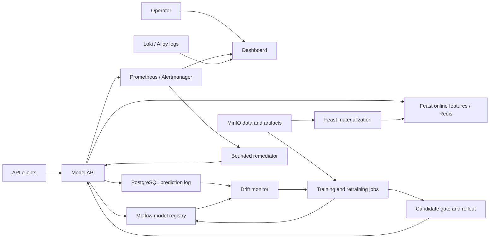
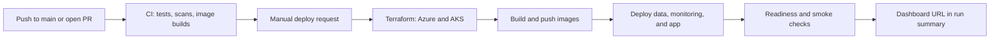

# MLPlatform

MLPlatform is a cloud-hosted MLOps demonstration for credit-default prediction. It takes a dataset through feature preparation, model training, registration, deployment, prediction serving, drift monitoring, retraining, and guarded model release. The application runs on Azure Kubernetes Service (AKS); GitHub Actions and Terraform provision and operate the cloud environment.

This is an engineering demonstration, not a validated lending product. Its credit data comes from the UCI Taiwan Credit Card Default dataset, and some feature timelines and drift scenarios are simulated.

## What it includes

| Area | Implementation |
| --- | --- |
| Data and features | Parquet snapshots in MinIO; Feast definitions and online features in Redis |
| Training and registry | Scikit-learn training jobs; model versions, metrics, and artifacts in MLflow |
| Serving | FastAPI prediction API with request IDs, bearer-token authentication, and a pinned model version |
| Monitoring | Prediction records in PostgreSQL; Prometheus metrics and alerts; logs in Loki |
| Model maintenance | Drift detection, retraining jobs, candidate evaluation, staged rollout, and rollback |
| Operations | Authenticated dashboard with health, monitoring, model status, and demo actions |
| Infrastructure | Terraform-managed Azure resources and Kubernetes workloads; seven Docker image targets |

## Architecture



The prediction path reads a customer's online features from Redis, scores them with a specific MLflow model version, and returns a probability and label. It queues the feature vector and score for an asynchronous PostgreSQL write. The bounded queue keeps database latency out of the response path, though records can be dropped if the queue fills or a final flush fails; metrics and logs expose those failures.

The drift monitor compares recent prediction features with the serving model's reference data. A retraining job starts only after enough samples, repeated threshold breaches, no active retrain job, and a cooldown. A candidate then has to pass evaluation checks before it can replace the champion. The release script tests staging, updates the MLflow alias, rolls serving, verifies it, and restores the previous version if a post-promotion check fails.

## How delivery works



**CI is automatic; cloud deployment is manual.** [CI](.github/workflows/ci.yml) runs on pull requests and pushes to `main`. It checks Python code and tests, Terraform and Kubernetes definitions, secrets and dependencies, and all seven container image targets. CI does not deploy the application.

The [Azure workflow](.github/workflows/cd.yml) runs only when dispatched manually for an operation such as `deploy`, `verify`, or `kill`, or when the application dispatches a model-release event. It requires a successful `quality` and `security` check for the exact commit before a deploy. Its deployment job uses the `azure` GitHub Environment and short-lived Azure OIDC credentials. A separate [expiry workflow](.github/workflows/expiry.yml) checks for expired test deployments every 15 minutes.

### Start a cloud deployment

You need GitHub CLI (`gh`) authenticated with write access to this repository. The `azure` GitHub Environment and its Azure OIDC identity must already be configured. Run these commands from the repository root:

```bash
gh auth status
gh workflow run cd.yml --ref main -f action=deploy -f confirmation=DEPLOY
gh run list --workflow cd.yml --limit 5
gh run watch <RUN_ID> --exit-status
gh run view <RUN_ID> --web
```

Copy the numeric ID of the **newest `azure` run** from `gh run list` into the last two commands. The completed run's summary is the source of truth for the dashboard and model API addresses. Do not rely on an address from a previous run. The dashboard uses username `admin`; its password is stored in a Kubernetes Secret, not in this repository. The test dashboard uses a self-signed certificate.

Deployment provisions billable Azure resources. Test resources are tagged to expire about two hours after a successful deployment; scheduled cleanup can run later than the deadline. No local application server or local Kubernetes deployment is provided by this repository.

### Stop and delete the test deployment

```bash
gh workflow run cd.yml --ref main -f action=kill -f confirmation=KILL
gh run list --workflow cd.yml --limit 5
gh run watch <NEW_RUN_ID> --exit-status
```

`kill` removes the project's Azure application, AKS node, and Terraform state resource groups. It also removes the test model and data history. The GitHub OIDC identity remains available for a later deployment.

### First-time Azure setup

An Azure administrator can run `make azure-connect` once after signing in with Azure CLI and GitHub CLI. It configures the repository's Azure deployment identity and GitHub Environment variables; it does **not** deploy the application. `make azure-preflight` checks Azure eligibility and capacity without provisioning the app. See [`scripts/azure.sh`](scripts/azure.sh) and [`scripts/azure_preflight.sh`](scripts/azure_preflight.sh) for the exact checks and resources.

## Runtime components

### Data, features, and training

[`core/ml/data/generate.py`](core/ml/data/generate.py) prepares deterministic feature and label snapshots from the UCI dataset. [`core/feature_repo/definitions.py`](core/feature_repo/definitions.py) defines the Feast entity, feature view, and feature service. Deployment publishes Parquet files to MinIO, applies the Feast definitions, materializes online features to Redis, and verifies both offline and online reads.

[`core/ml/train.py`](core/ml/train.py) joins labels to point-in-time features, uses a chronological train/validation/test split, trains a `HistGradientBoostingClassifier`, and logs metrics and reference artifacts to MLflow. The first registered model becomes the `champion`; later versions are candidates. The generated snapshot dates are demonstration data, not actual historical observation dates.

### Prediction API

[`core/model_api/`](core/model_api/) contains the FastAPI service. It loads a pinned numeric model version from MLflow and reads online features from Redis. `/predict` accepts a batch of customer IDs and returns scores, labels, a model version, and a request ID. Unknown customers and malformed inputs receive explicit errors. `/model-info` exposes the loaded version; `/healthz`, `/readyz`, and `/metrics` support probes and monitoring. Prediction and model information routes require a bearer token when `MODEL_API_TOKEN` is configured.

### Drift, retraining, and release

[`core/drift_monitor/`](core/drift_monitor/) compares recent prediction feature distributions against the champion's reference artifact using PSI and Kolmogorov–Smirnov checks. The trigger requires enough data, consecutive breaches, and a cooldown. [`core/retrain/`](core/retrain/) launches a Kubernetes training job and registers a candidate without immediately changing production.

[`scripts/gate.py`](scripts/gate.py) checks candidate AUC, regression against the champion on the same holdout, feature compatibility, prediction rate, and a scoring smoke test. [`scripts/model_release.sh`](scripts/model_release.sh) stages and load-checks an approved candidate, promotes it, verifies serving, and rolls back on failure.

### Dashboard and observability

[`ui/app.py`](ui/app.py) serves an authenticated operations dashboard. It combines Kubernetes status, model metadata, Prometheus metrics and alerts, MLflow state, and MinIO health. The UI includes prediction and customer demo views, pod and log inspection, retraining status, and controlled demo actions such as drift simulation. Grafana is available through the dashboard's `/grafana/` path.

Prometheus and Alertmanager collect and evaluate health and latency metrics; Loki and Alloy handle logs. [`core/remediator/`](core/remediator/) handles only explicit alert mappings: it can raise the model API HPA minimum for high latency, restart the API deployment when it is down, or annotate an event. Drift retraining remains governed by the drift monitor rather than by alert delivery.

## Infrastructure and security

[`infra/envs/azure/`](infra/envs/azure/) creates the Azure resource group, network, registry, AKS cluster, public IP, and budget notification. [`infra/envs/aks/`](infra/envs/aks/) applies Kubernetes resources in stages: namespaces and CRDs, data and observability services, then application workloads. [`infra/Dockerfile`](infra/Dockerfile) defines the seven image targets. The deployment does not use Helm.

GitHub Actions authenticates to Azure with OIDC rather than a stored Azure client secret. Terraform generates the database, MinIO, Grafana, and model API credentials and stores them as Kubernetes Secrets. The rendered Feast configuration, Terraform state and plans, local `.env` files, generated data, and model artifacts are ignored by Git. Public workflow logs still require care: do not print credentials in scripts or diagnostics.

The model API is a separate public endpoint with authenticated prediction routes. The dashboard uses Basic authentication; `/healthz` remains available for the load balancer. The demo certificate is self-signed. These choices support a short-lived demonstration and are not a production security assessment.

## Develop and validate

Python 3.11, `uv`, Terraform, Docker, and the validation tools used by the Makefile are needed for the full local check suite. `uv.lock` pins the Python dependency graph. Local commands validate code and images; they do not start the cloud application.

```bash
uv sync --frozen --all-groups
make lint test
make check-infra check-actions check-manifests
make secret-scan security
make check-images
```

`make test` runs the unit suite with a coverage gate. `make check-images` builds and import-smokes all seven Docker targets. `make help` lists other supported targets. CI runs the same key checks on GitHub-hosted runners.

## Repository guide

| Path | Purpose |
| --- | --- |
| [`core/ml/`](core/ml/) and [`core/feature_repo/`](core/feature_repo/) | Data preparation, Feast definitions, training, and evaluation |
| [`core/model_api/`](core/model_api/) | Prediction service and asynchronous prediction logging |
| [`core/drift_monitor/`](core/drift_monitor/) and [`core/retrain/`](core/retrain/) | Drift detection and candidate creation |
| [`core/remediator/`](core/remediator/) | Alert-driven, bounded Kubernetes actions |
| [`ui/`](ui/) | Authenticated operations dashboard |
| [`infra/`](infra/) | Terraform roots, Kubernetes templates, jobs, and Dockerfile |
| [`scripts/`](scripts/) | Cloud orchestration, release, smoke checks, and demo tools |
| [`.github/workflows/`](.github/workflows/) | CI, manual Azure operations, and scheduled expiry |
| [`tests/`](tests/) | Unit and cloud contract tests |
| [`Makefile`](Makefile) | Local lint,test,infra,security,and image checks |
## Scope and limitations

- The project demonstrates an MLOps workflow, not a clinically or financially validated credit decision system. Do not use its predictions for any real lending decisions.
- UCI labels and simulated feature timelines make the workflow reproducible, but they do not establish live-data performance or temporal validity.
- Drift and failure injection are controlled demonstrations. Retraining still requires a candidate to pass the evaluation gate before promotion.
- A successful CI run proves source checks passed for that commit. A successful Azure deploy run and its smoke checks are required to confirm that the cloud application started.
- The test deployment is temporary. Its URL, IP addresses, model history, and data can change or disappear after teardown or expiry.
