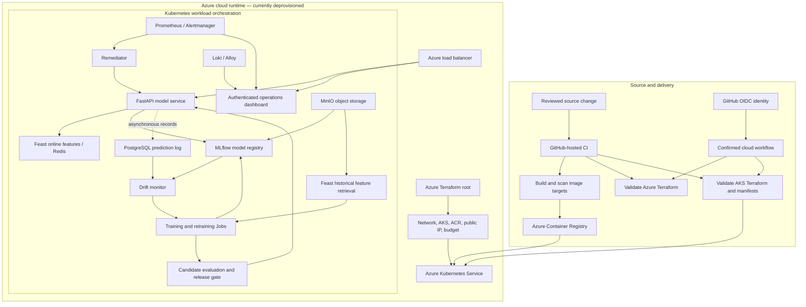
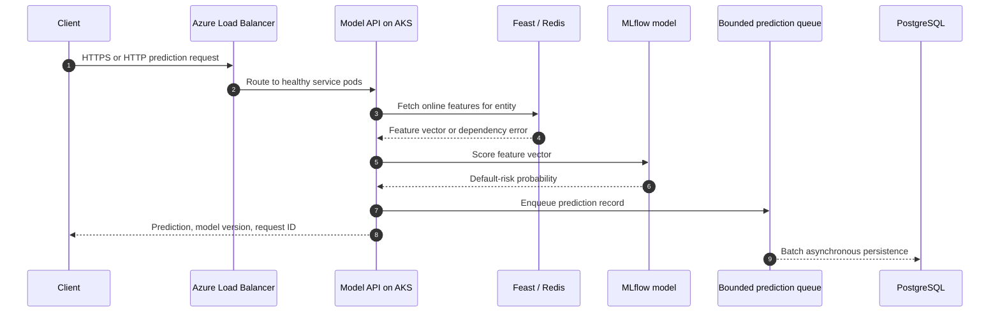

# MLPlatform

**A cloud-first credit-risk MLOps platform on Azure Kubernetes Service.** Terraform defines the Azure foundation and every Kubernetes workload. GitHub-hosted Actions builds, validates, and operates the cloud environment; the application itself is not hosted on a developer workstation.

> **Current status — 22 October 2026:** The project Azure resources have been removed and deployment workflows were disabled to prevent unexpected project charges. The application is **not running**. The repository contains the cloud implementation and validation checks, but this revision has not been redeployed. Do not use historical endpoints as live addresses.

## What it does

MLPlatform connects the lifecycle of a tabular credit-risk model:

- Fetch historical features, train and evaluate a model, then register its artifacts and version in MLflow.
- Serve predictions through FastAPI using online features from Feast and Redis.
- Record prediction details asynchronously in PostgreSQL so database work does not block inference responses.
- Compare recent feature distributions with a training reference and apply safeguards before requesting retraining.
- Gate candidate models before a controlled release to the AKS serving deployment.
- Collect metrics, alerts and logs with Prometheus, Alertmanager, Grafana, Loki and Alloy; apply a small set of automated remediation actions.
- Provide an authenticated operations dashboard hosted in AKS.

This is an engineering demonstration, not a validated lending product. The source dataset is the UCI Taiwan Credit Card Default dataset. Snapshot timelines and injected drift are simulated. No current model-quality, fairness, latency or availability result is claimed.

## Architecture



The diagram shows the **intended cloud design**, not resources currently running. Terraform validation and source tests pass independently of a live Azure subscription; deployment and live service behavior require an explicitly authorized cloud run.

### Prediction request path



The prediction response and its database write are separate operations. The queue is bounded: if it remains full or a final flush fails, some records may be dropped and surfaced through logs/metrics. A successful HTTP response alone is not proof that its prediction record was persisted.

### Provisioning and dependency order

```mermaid
flowchart LR
    A[GitHub-hosted workflow<br/>OIDC + explicit action] --> B[Azure Terraform root]
    B --> C[Resource group, network,<br/>AKS, ACR, public IP, budget]
    C --> D[AKS Terraform bootstrap<br/>namespaces and CRDs]
    D --> E[Platform stage<br/>data and observability]
    E --> F[Training and model artifact]
    F --> G[Application stage<br/>API, dashboard, monitor, jobs]
    G --> H[Smoke checks and monitoring]
    H --> I[Authorized teardown]
```



Two Terraform roots reflect different lifecycles: `infra/envs/azure` creates Azure infrastructure, while `infra/envs/aks` manages Kubernetes resources through the Kubernetes provider. The AKS root stages bootstrap, platform and application resources because CRDs, namespaces, data services and initial model artifacts have dependencies. Terraform remains the declared source of deployment state; release operations update Terraform-created workloads, and a later full Terraform apply reconciles the declared configuration.

## Architectural decisions

| Decision | Reason | Trade-off |
|---|---|---|
| AKS is the only application runtime | Provides Kubernetes scheduling, service discovery, rolling deployments, health probes, Jobs and autoscaling in the cloud | A live environment has ongoing cost and requires cluster operations; there is no local app fallback |
| Terraform owns Azure and Kubernetes resources | Keeps infrastructure and workload definitions reviewable and repeatable | Custom resources and multi-stage dependencies require careful ordering and Terraform state handling |
| Azure infrastructure and AKS workloads use separate Terraform roots | Separates cloud resource lifecycle from in-cluster resource lifecycle | Operators must apply the roots in the documented sequence |
| GitHub-hosted Actions handles CI and selected cloud operations | Keeps application hosting off workstations and uses OIDC for Azure authentication | Cloud operations depend on workflow configuration, GitHub environment settings and guarded dispatch |
| Feast connects historical training features to online inference features | Reduces training/serving feature divergence and supports point-in-time retrieval | Online serving depends on Redis and correct materialization/network setup |
| MLflow stores model versions and artifacts | Makes the selected model version and its evaluation artifacts identifiable | Registry and artifact storage must be available before serving or training |
| Asynchronous bounded prediction logging | Prevents a database round trip from holding up each prediction response | Queue pressure or shutdown failures can drop records and must be monitored |
| Drift detection and release gating are separate | Drift can request retraining, while a candidate must independently pass checks before promotion | Retraining and promotion have more steps and need explicit operational observability |
| Public services use restricted source ranges | Allows intended access while constraining inbound network paths | Access requires an allowed client or workflow runner CIDR |

## Technology checklist

| Requested item | In this project? | Evidence / meaning |
|---|---|---|
| **Kubernetes** | **Yes** | Azure Kubernetes Service (AKS) runs the API, dashboard, data services, training/retraining Jobs, drift monitor, and observability workloads. Kubernetes resources are managed with Terraform. |
| **Load balancing** | **Yes** | AKS `Service` resources of type `LoadBalancer` expose the model API and dashboard through Azure’s load-balancer integration and a Terraform-managed public IP. Other internal services use `ClusterIP`. This is configuration evidence; the public endpoint is currently deprovisioned. |
| **Orchestration** | **Yes** | Kubernetes orchestrates containers, health checks, rollouts, Jobs and scaling. Terraform separately orchestrates resource provisioning in staged roots. |
| **Dockerfile(s)** | **Yes — one Dockerfile** | [`infra/Dockerfile`](infra/Dockerfile) is a multi-stage Dockerfile with named targets for model API, drift monitor, remediator, training/retraining, MLflow and dashboard images. There are not separate Dockerfiles for each service. |

## Repository map

| Path | Responsibility |
|---|---|
| `core/model_api/` | FastAPI prediction service, dependency setup, providers and asynchronous prediction logging |
| `core/ml/`, `core/feature_repo/` | Data preparation, Feast configuration, training, evaluation and model registration |
| `core/drift_monitor/`, `core/retrain/`, `core/remediator/` | Drift analysis, retraining dispatch and bounded remediation actions |
| `ui/` | Operations dashboard served as an AKS workload |
| `infra/envs/azure/` | Azure infrastructure Terraform root |
| `infra/envs/aks/` | Kubernetes workload Terraform root |
| `infra/manifests/`, `infra/jobs/` | Terraform input snapshots and Kubernetes Job definitions |
| `infra/Dockerfile` | Multi-stage container builds for cloud workload images |
| `scripts/` | Cloud workflow helpers, release gates, smoke/load checks and demo operations |
| `.github/workflows/` | Hosted CI and guarded Azure operations |
| `tests/` | Unit tests and cloud configuration contract tests |
| `docs/` | Architecture, decisions, specification, runbooks, versions and deployment history |

## Checks

The following checks can run in CI or a developer environment; they test code/configuration and do not start a local application runtime:

```bash
make lint test
make check-infra check-actions check-manifests
make secret-scan security
```

`make check-images` builds and smoke-checks the configured image targets and may need significant disk space. Terraform and manifest validation do not provision Azure resources. No command in this section is a live deployment or a local app launch.

## Cloud operations and cost

Cloud deployment is an explicit operational action through the GitHub **azure** workflow. Azure authentication uses OIDC; destructive and billable actions require the workflow’s confirmation and ownership checks. A deployment requires a reviewed Terraform plan, approved test window, current identity configuration, budget review and teardown plan. Do not dispatch a billable action just to verify that the code builds.

The project resource groups and deployment identity role assignments were removed, and project deployment/expiry workflows were disabled as of the status date above. The README does not promise that unrelated Azure resources or other subscriptions have no charges. See [Azure operations and historical deployment notes](docs/azure-port.md).

## Documentation

- [Architecture and system flow](docs/architecture.md)
- [Architecture decisions](docs/DECISIONS.md)
- [Cloud-only behavior and acceptance scope](docs/SPEC.md)
- [Operations runbook](docs/runbook.md)
- [AKS demo sequence](docs/DEMO.md)
- [Azure deployment history and operations](docs/azure-port.md)
- [Pinned tool and service versions](docs/VERSIONS.md)
- [Terraform-managed manifest snapshots](infra/manifests/README.md)
