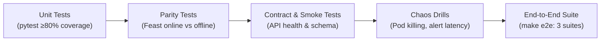

# Technical Design Document (TDD) — Autonomous Self-Healing ML Platform (P10.3)

**Author:** Autonomous Engineering Agent  
**Status:** Approved & Implemented  
**Date:** 2026-10-04  
**Target Environment:** Local Kubernetes (Kind) & AWS Parity (EKS, RDS, S3, ECR)

---

## 1. Problem Statement & Context

Modern Machine Learning in production faces two existential challenges:
1. **Silent Model Degradation:** Machine learning models are not static software. Over time, shifting customer behaviors, macroeconomic shifts, or data pipeline perturbations cause *data drift* (distribution of input features shifts) and *concept drift* (relationship between features and targets shifts). Traditional ML systems detect this only weeks or months later after downstream business metrics plummet.
2. **Operational Fragility & Separation of Concerns:** ML systems frequently operate in silos separate from software engineering best practices. Common anti-patterns include training-serving feature skew, baking serialized model weights into Docker container images, manual ad-hoc retraining on local workstations, unverified deployments without latency or error budgets, and system crashes when underlying databases or caches experience transient outages.

### Objective
Design and implement a resilient, autonomous, closed-loop machine learning platform that serves real-time credit scoring predictions, guarantees feature parity between training and serving, detects statistical drift automatically, triggers verified retraining pipelines, and recovers gracefully from both infrastructure faults and model degradation.

---

## 2. Goals & Non-Goals

### 2.1 Goals
* **Sub-50ms P95 Serving Latency:** High-throughput REST API serving predictions with asynchronous, non-blocking prediction logging.
* **Zero Training-Serving Skew:** Point-in-time correct historical feature joins for training and sub-millisecond Redis online feature hydration via a centralized Feature Store (Feast). Parity difference $\le 10^{-6}$.
* **Closed-Loop Model Self-Healing:** Autonomous statistical drift detection (PSI > 0.20 or KS $p < 0.01$) triggering a verified Kubernetes retraining Job that evaluates on hold-out data, passes strict quality gates, and rolls out zero-downtime updates.
* **Infrastructure Self-Healing:** Kubernetes ReplicaSet reconciliation, Horizontal Pod Autoscaling (HPA), and an automated incident remediation service (`remediator`) that responds to Prometheus alerts by dynamically scaling replicas and annotating Grafana.
* **100% Infrastructure-as-Code (IaC):** Every cluster component, data store, and monitoring stack is defined in OpenTofu and Helm, deployable locally via `make up` with zero manual steps, with exact AWS cloud parity.
* **Enterprise Hardening:** Non-root containers (`10001:10001`), read-only root filesystems, Kubernetes NetworkPolicies (default-deny), RBAC least privilege, and zero secrets in git history.

### 2.2 Non-Goals
* Multi-region active-active geographic replication.
* Distributed multi-node GPU training (platform targets tabular models like LightGBM).
* Direct consumer frontend portal (Swagger UI, FastAPI `/docs`, and Grafana dashboards serve as the operational interfaces).
* Hyperparameter optimization sweeps (Optuna/Ray).

---

## 3. High-Level Architecture & Technical Design

The platform is structured into three decoupled Kubernetes namespaces:

```
┌─────────────────────────────────────────────────────────────────────────────┐
│                          KUBERNETES CLUSTER (Kind / EKS)                    │
│                                                                             │
│  ┌───────────────────────┐  ┌──────────────────────┐  ┌──────────────────┐  │
│  │  Namespace: serving   │  │   Namespace: data    │  │  Namespace:      │  │
│  │                       │  │                      │  │  observability   │  │
│  │  • model-api (HPA)    │  │  • Feast (Redis)     │  │  • Prometheus    │  │
│  │  • model-api-staging  │  │  • PostgreSQL 16     │  │  • Alertmanager  │  │
│  │  • NetworkPolicy      │  │  • MinIO (S3 Parity) │  │  • Loki + Alloy  │  │
│  │    (Default-Deny)     │  │  • MLflow Tracking   │  │  • Grafana (3x)  │  │
│  │                       │  │  • drift-monitor     │  │  • remediator    │  │
│  │                       │  │  • retrain Job       │  │    (/alert hook) │  │
│  └───────────────────────┘  └──────────────────────┘  └──────────────────┘  │
└─────────────────────────────────────────────────────────────────────────────┘
```

### 3.1 Serving Layer (`model-api`)
* **Technology:** FastAPI, Python 3.11, Uvicorn, Pydantic v2.
* **Decoupled Architecture:** The container image contains **no models and no data**.
* **Model Loading:** At pod startup, the service fetches the pinned model version (`models:/loan-default/${MODEL_VERSION}`) directly from the MLflow registry. If MLflow is unreachable, the startup probe fails, keeping unready pods out of Service endpoints.
* **Online Feature Hydration:** Given an incoming `customer_id`, `model-api` calls Feast's online store (`redis://redis.data.svc:6379/0`), retrieving customer credit vectors in $<2$ms.
* **Asynchronous Prediction Logging:** A dedicated `PredictionLogger` worker maintains a thread-safe in-memory queue. Inferences are pushed immediately to memory ($<0.1$ms overhead) and flushed in background micro-batches to PostgreSQL (`prediction_log`). If PostgreSQL restarts, user traffic remains 200 OK.

### 3.2 Feature Store & Parity (`Feast`)
* **Entity:** `customer_id`.
* **Feature View:** `customer_credit_features` (credit_score, income, debt_to_income, loan_amount, employment_length, delinq_2yrs).
* **Parity Enforcement:** Training utilizes `store.get_historical_features(entity_df)` with point-in-time correctness to prevent future leakage. Serving uses `store.get_online_features()`. Parity is verified via automated unit test `tests/test_parity.py`.

### 3.3 Autonomous Model Self-Healing Loop (`drift-monitor` & `retrain`)
* **Statistical Evaluation:** The `drift-monitor` queries recent inferences from `prediction_log` and compares feature distributions against the frozen `reference.parquet` artifact logged in the champion model's MLflow run.
* **Metrics:** Population Stability Index (PSI, 10 quantile bins) and Kolmogorov-Smirnov (KS two-sample test).
* **Safeguards:** Retraining is triggered only if:
  1. Minimum sample count is met ($N \ge 500$).
  2. Drift breaches threshold across $K=2$ consecutive evaluations (debounce).
  3. Cooldown window (10 minutes) has elapsed since the last retraining.
  4. No active retrain job is currently running on the cluster.
* **Execution:** Spawns an ephemeral Kubernetes Job (`retrain-*`) in `data` namespace.
* **Quality Gate (`gate.py`):** Before promotion, the candidate must satisfy:
  * Test AUC $\ge 0.70$ (absolute quality floor).
  * Candidate AUC $\ge$ Champion AUC $- 0.02$ (regression protection).
  * Schema compatibility with active Feast feature service.
  * 2,000-request staging load check ($P95 \le 100$ms, $0\%$ errors).
* **Atomic Deployment:** On passing gate, the candidate is aliased to `champion` in MLflow, and Helm executes a rolling update on `model-api` with `model.version=<N>`.

### 3.4 Infrastructure Self-Healing & Remediation (`remediator`)
* Prometheus scrapes `/metrics` across all namespaces using ServiceMonitors.
* Alert rules fire on latency (`HighP95Latency`), errors (`HighErrorRate`), or pod restarts (`PodCrashLooping`).
* Alertmanager dispatches alerts to the `remediator` FastAPI webhook.
* Remediator executes targeted, auditable actions:
  * Raises HPA `minReplicas` (e.g. 2 $\rightarrow$ 4) to absorb traffic surges.
  * Emits Grafana event annotations marking the incident timeline.
  * Triggers Kubernetes rollout restarts for crashing pods.

---

## 4. Alternatives Considered & Technical Rationales

| Decision Area | Selected Approach | Alternative Rejected | Rationale |
|---|---|---|---|
| **Cloud vs Local Parity** | Kind + OpenTofu + MinIO/Postgres/Redis | AWS-only or LocalStack | AWS development incurs hourly billing; LocalStack restricted its free tier. Kind + OpenTofu provides 100% free, reproducible local parity with standard Kubernetes/S3 APIs. |
| **Model Versioning** | Pinned Helm `model.version=<N>` | Floating on MLflow `champion` alias | Dynamic alias resolution creates non-deterministic cluster state, breaks GitOps, and prevents reproducible rollbacks. Pinned versions guarantee immutable deployments. |
| **Drift Baseline** | `reference.parquet` in MLflow Run | Rolling baseline / Global fixed baseline | Rolling baselines normalize drift over time, hiding gradual degradation. Fixed global baselines cause endless retraining loops because retrained models are measured against obsolete data. |
| **Prediction Logging** | In-Memory Async Worker Queue | Synchronous database INSERT | Synchronous writes add 5-15ms DB roundtrip latency to the critical path and drop user traffic if the database experiences brief restarts. |
| **Log Collection** | Grafana Alloy | Promtail | Promtail has been officially deprecated and reached End-of-Life (EOL) by Grafana Labs; Alloy is the designated long-term telemetry collector. |
| **Feature Store** | Feast | Custom SQL views / DynamoDB | Feast provides standardized feature definitions, built-in point-in-time historical joins, and seamless dual-store (Redis/S3) orchestration. |

---

## 5. Security & Compliance Architecture

* **Container Isolation:**
  * All Dockerfiles enforce `USER 10001:10001` (non-root).
  * Container security contexts enforce `runAsNonRoot: true`, `readOnlyRootFilesystem: true`, and drop `ALL` Linux capabilities.
  * `seccompProfile: {type: RuntimeDefault}` enabled across all deployments.
* **Network Security:**
  * Kubernetes `NetworkPolicy` enforces a default-deny ingress and egress posture in the `serving` namespace.
  * Egress is whitelisted exclusively to Kubernetes DNS (UDP/TCP 53) and data services in the `data` namespace (Redis 6379, Postgres 5432, MLflow 5000, MinIO 9000).
* **RBAC Least Privilege:**
  * Remediator ServiceAccount is restricted via `Role` to patching HPAs and Deployments in `serving`.
  * Drift-monitor ServiceAccount is restricted via `Role` to managing batch Jobs in `data`.
  * Pods have no cluster-wide admin rights (`cluster-admin` prohibited).
* **Secret Hygiene:**
  * Zero credentials in Git history (verified by `gitleaks` container scanning 48+ commits).
  * Secrets provisioned dynamically via OpenTofu `random_password` or AWS IRSA.

---

## 6. Financial Cost Analysis & Cloud Budgeting

### 6.1 Local Development
* **Cost:** **\$0.00** (runs entirely within laptop resources: 8 CPU, 16 GB RAM).

### 6.2 AWS Parity Deployment (P9.5 / P9.6)
* **Estimated Hourly Run Rate:** ~\$0.27 / hour (~\$0.85 per 3-hour demo window).
* **Cost Control Guardrails:**
  * AWS Budgets alert set at \$50 monthly ceiling with automated SNS email notifications.
  * Micro/medium instance sizing (`t3.medium` worker nodes, `db.t3.micro` RDS).
  * In-cluster Redis and optional NodePort ingress to eliminate extra NAT/ELB fees.
  * Immediate automated teardown via `make aws-destroy`.

---

## 7. Verification & Testing Strategy



1. **Unit Testing:** `pytest` covering `mlp_common`, `model_api`, `drift_monitor`, `remediator`, and `retrain` with $\ge 80\%$ line coverage.
2. **Feature Parity Testing:** `tests/test_parity.py` asserts feature equality between `get_historical_features` and `get_online_features` across 200 random entities within $10^{-6}$ tolerance.
3. **Fault Injection & Chaos Testing:**
   * `chaos_pod.sh`: Deletes active serving pods under continuous 20 RPS traffic; verifies $<1\%$ error budget.
   * `chaos_alert.sh`: Injects artificial P95 latency; verifies alert firing and automated HPA floor expansion.
   * `verify_failure_modes.sh`: Proves Postgres down buffering, Redis cache recovery, and MinIO isolation.
4. **End-to-End Verification:** `make e2e` runs unattended validation of serving contracts, infrastructure resilience, and the closed-loop retraining cycle.

---

## 8. Limitations & Future Roadmap

### 8.1 Current Limitations
* **Database Single Point of Failure:** PostgreSQL is deployed as a single-replica StatefulSet locally. In production AWS, RDS Multi-AZ eliminates this limitation.
* **In-Memory Buffer Eviction:** Under catastrophic, prolonged database outages exceeding 10,000 requests, oldest buffer records are dropped to protect system memory.
* **Synchronous Candidate Staging:** Release validation uses a separate staging namespace rather than dynamic canary traffic splitting.

### 8.2 Future Roadmap
1. **Canary & Shadow Traffic:** Implement Istio or Linkerd service mesh to mirror 5% of production traffic to candidate models before full rollout.
2. **Streaming Feature Ingestion:** Integrate Kafka / Apache Flink with Feast for real-time feature streaming and real-time aggregation windows.
3. **Automated Continuous Evaluation:** Ingest true customer loan repayment outcomes asynchronously via event streams to calculate real-world AUC degradation alongside feature drift.
