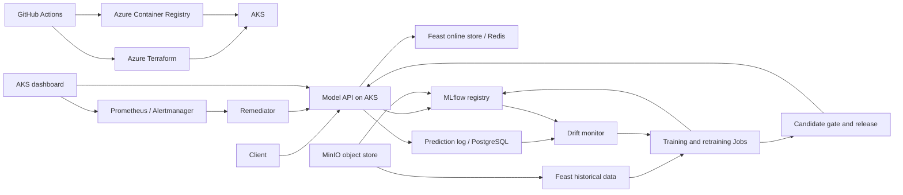

# Cloud architecture

Azure Terraform provisions the cloud infrastructure. The AKS Terraform root installs workloads in the `data`, `serving`, `staging`, and `observability` namespaces. The model API loads MLflow models and Feast online features. Training uses Feast historical retrieval, a temporal split, and MLflow registry artifacts. Drift monitoring, retraining, release gates, and remediation run as AKS workloads.

The dashboard is an AKS service with authentication. Its demo baseline is an MLflow model artifact cached inside its cloud pod. GitHub runners build images and seed demo data; they do not host the application. The UCI credit dataset is real source data, while generated snapshots and injected drift are simulated.
